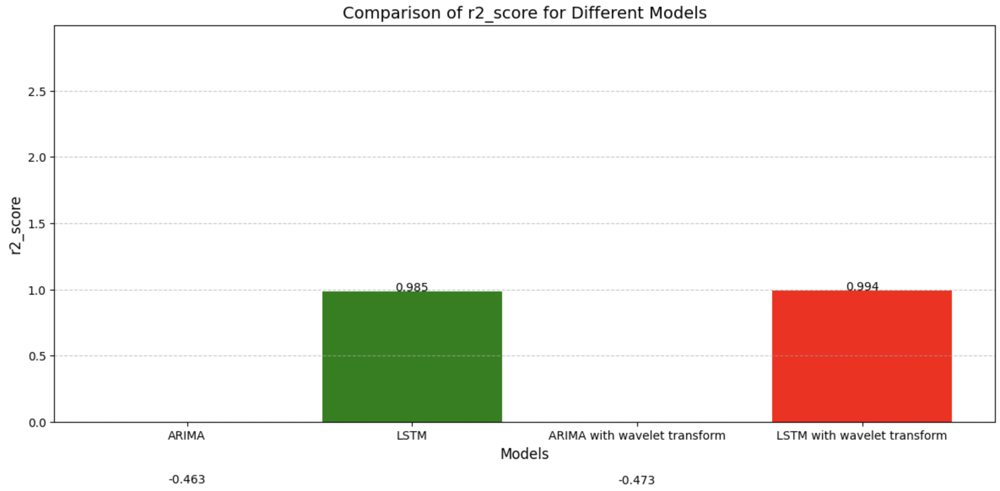
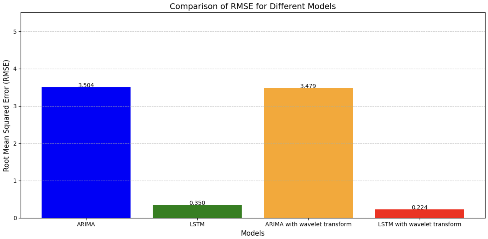
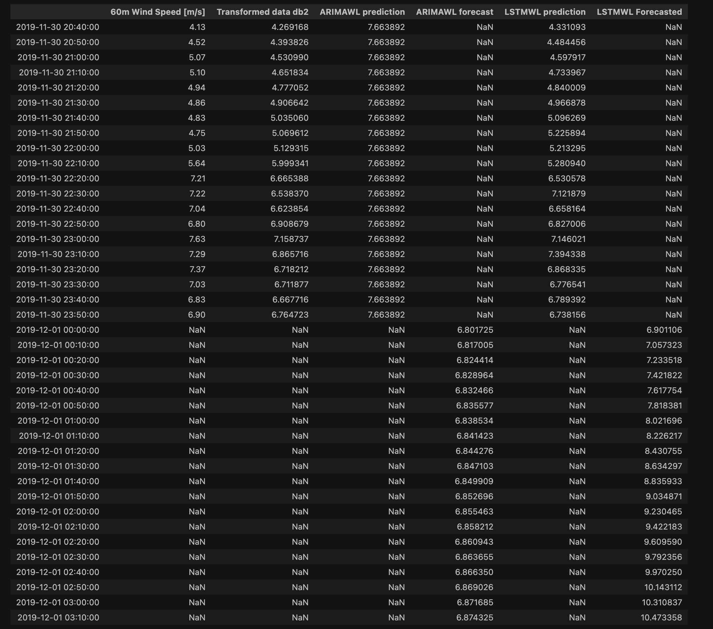

# Wind Power Prediction & Forecasting Using Wavelet-LSTM Hybrid Architecture

## 📋 Overview

Wind power generation is inherently volatile and non-stationary due to atmospheric turbulence, environmental variations, and sensor noise. This project implements a hybrid time-series forecasting framework that combines **Discrete Wavelet Transform (DWT)** using the `PyWavelets` library and a **Long Short-Term Memory (LSTM)** neural network to improve wind power prediction.

The framework uses the **Daubechies 2 (`db2`) wavelet** to decompose and denoise time-series signals, enabling the LSTM model to learn meaningful temporal patterns while reducing the influence of high-frequency noise.

The pipeline benchmarks classical statistical methods against deep learning architectures using both raw and wavelet-processed data to evaluate the impact of wavelet-based feature extraction on forecasting performance.

### Key Features

- **Wavelet-Based Denoising:** Applies the `db2` Discrete Wavelet Transform to extract meaningful signal components and reduce noise.
- **Stacked LSTM Architecture:** Uses a two-layer LSTM network to learn complex temporal dependencies in wind power time series.
- **Comparative Benchmarking:** Evaluates ARIMA, ARIMA with wavelet processing, raw-data LSTM, and the hybrid Wavelet-LSTM model.
- **Multi-Step Forecasting:** Generates iterative forecasts for a 300-minute prediction horizon at 10-minute intervals.
- **Performance Evaluation:** Compares model performance using Root Mean Squared Error (RMSE) and the coefficient of determination (\(R^2\)).
- **Visualization:** Produces comparative evaluation charts and multi-step forecasting plots.

---

## 🗂️ Project Structure

```text
├── data/
│   └── wind_power_time_series.csv
│       # Raw wind speed/power time-series data
│
├── wind_power_forecasting.ipynb
│       # Complete modeling pipeline and evaluation
│
├── assets/
│   ├── r2_score_comparison.png
│   │   # R² comparison across forecasting models
│   ├── rmse_comparison.png
│   │   # RMSE comparison across forecasting models
│   └── forecast_plot.png
│       # Multi-step forecast visualization
│
├── requirements.txt
│   # Project dependencies
│
└── README.md
    # Project documentation
```

---

## ⚙️ Methodology

### 1. Data Preprocessing

The wind power time-series dataset is loaded and prepared for forecasting. The preprocessing pipeline organizes the sequential observations and applies the required transformations for statistical modeling and deep learning.

For the LSTM-based models, the data is scaled to improve numerical stability and support efficient model training.

### 2. Wavelet Decomposition and Denoising

The **Discrete Wavelet Transform (DWT)** is applied using the Daubechies 2 (`db2`) wavelet.

Wavelet decomposition separates the original time-series signal into approximation and detail coefficients, representing different frequency components.

This process helps distinguish the underlying temporal patterns from high-frequency fluctuations and noise, potentially improving the quality of the input representation used by the forecasting model.

### 3. Stacked LSTM Architecture

The deep learning component uses a two-layer stacked LSTM network with the following configuration:

| Parameter | Configuration |
|---|---|
| Architecture | Stacked LSTM |
| Number of LSTM layers | 2 |
| Units per layer | 50 |
| Optimizer | Adam |
| Loss function | Mean Squared Error (MSE) |
| Regularization strategy | Early stopping |
| Early stopping patience | 15 epochs |

The LSTM network learns temporal dependencies from sequential observations and uses these patterns to predict future wind power values.

Early stopping helps reduce unnecessary training and mitigates overfitting by monitoring model performance during training.

### 4. Iterative Multi-Step Forecasting

The forecasting module implements an autoregressive rollout strategy to generate predictions over an extended horizon.

- **Forecast interval:** 10 minutes
- **Number of forecast steps:** 30
- **Total forecast horizon:** 300 minutes (5 hours)

At each iteration, the model predicts the next time step and incorporates the prediction into the input sequence for the subsequent forecast.

This approach enables multi-step prediction beyond the observed input window.

### 5. Model Evaluation

The framework evaluates four forecasting configurations:

1. **ARIMA:** Statistical baseline trained on the raw time series.
2. **ARIMA + Wavelet Transform:** ARIMA-based forecasting using wavelet-processed data.
3. **Stacked LSTM:** Deep learning model trained on raw, scaled data.
4. **Hybrid Wavelet-LSTM:** LSTM forecasting model using wavelet-denoised and scaled data.

Model performance is compared using RMSE and \(R^2\).

---

## 🚀 Getting Started

### Prerequisites

Ensure that Python and Jupyter Notebook are installed on your system.

### Installation

**1. Clone the repository**

```bash
git clone <https://github.com/TheRabiyaQuadri/windpower-forecasting-wavelet-LSTM>
cd <windpower-forecasting-wavelet-LSTM>
```

Replace the placeholders with your actual repository URL and directory name.

**2. Install the dependencies**

Using the provided requirements file:

```bash
pip install -r requirements.txt
```

Alternatively, install the main dependencies directly:

```bash
pip install numpy pandas matplotlib seaborn scikit-learn PyWavelets statsmodels tensorflow jupyter
```

**3. Prepare the dataset**

Place the wind power time-series dataset in the `data/` directory:

```text
data/wind_power_time_series.csv
```

Ensure that the dataset contains the time-series variables required by the notebook and that the column names match those expected by the implementation.

**4. Launch Jupyter Notebook**

```bash
jupyter notebook notebooks/wind_power_forecasting.ipynb
```

**5. Execute the pipeline**

Run the notebook cells sequentially to reproduce the data preprocessing, wavelet transformation, model training, evaluation, and multi-step forecasting workflow.

The notebook generates the evaluation plots and forecast visualizations in the `outputs/` directory, provided the output paths are configured accordingly.

---

## 📈 Quantitative Performance & Benchmarks

The following results summarize the reported performance of the four forecasting configurations.

| Model Architecture | Input Processing | RMSE ↓ | \(R^2\) Score ↑ |
|---|---|---:|---:|
| ARIMA (Baseline) | Raw time series | 3.504 | -0.463 |
| ARIMA + Wavelet Transform | `db2` wavelet-processed | 3.479 | -0.473 |
| Stacked LSTM | Raw scaled data | 0.350 | 0.985 |
| **Hybrid Wavelet-LSTM** | **`db2` denoised and scaled** | **0.224** | **0.994** |

*Note: These are the reported benchmark values. Their reproducibility depends on the dataset, preprocessing pipeline, train-test split, forecast target, scaling procedure, and evaluation methodology. RMSE values should be compared across models only when they use the same target scale and evaluation observations.*

### Key Findings

- **Lower prediction error:** The reported RMSE decreases from 0.350 for the raw-data LSTM to 0.224 for the hybrid Wavelet-LSTM model.
- **Improved forecasting performance:** The hybrid model achieves a reported \(R^2\) score of 0.994.
- **Potential benefit of wavelet processing:** The results indicate that combining wavelet-based signal processing with LSTM modeling can improve forecasting accuracy for this dataset.
- **Statistical baseline comparison:** The ARIMA configurations provide reference points for evaluating the performance of the deep learning models.

The relative RMSE reduction from the raw-data LSTM to the hybrid Wavelet-LSTM is approximately **36%**.

These findings suggest that wavelet preprocessing may help the LSTM capture relevant temporal structure while reducing the impact of noise.

---

## 📉 Execution Visualizations & Artifacts

### 1. Coefficient of Determination (\(R^2\)) Comparison

**File:** `assets/r2_score_comparison.png`

Visualizes the reported \(R^2\) scores of the forecasting models, illustrating their relative ability to explain the variance in the evaluation data.



### 2. Root Mean Squared Error (RMSE) Comparison

**File:** `assets/rmse_comparison.png`

Compares the prediction errors across the statistical, deep learning, and hybrid forecasting configurations. Lower RMSE values indicate smaller prediction errors on the evaluated target scale.



### 3. Multi-Step Wind Power Forecast

**File:** `assets/forecast_plot.png`

Displays the multi-step forecasting output over the 300-minute prediction horizon, with predictions generated at 10-minute intervals.



---

## 🧰 Technologies Used

- **Python** — Core programming language
- **NumPy** — Numerical computation
- **Pandas** — Data manipulation and preprocessing
- **Matplotlib** — Forecast and performance visualization
- **Seaborn** — Statistical visualization
- **Scikit-learn** — Data scaling and evaluation metrics
- **PyWavelets** — Discrete Wavelet Transform
- **Statsmodels** — ARIMA statistical forecasting
- **TensorFlow / Keras** — LSTM model development and training
- **Jupyter Notebook** — Interactive experimentation and analysis

---

## 🔬 Future Improvements

Potential extensions to the framework include:

- **Hyperparameter optimization:** Systematically tune LSTM architecture, sequence length, learning rate, and wavelet settings.
- **Alternative wavelet families:** Compare `db2` with other wavelets to evaluate their effects on denoising and forecast accuracy.
- **Probabilistic forecasting:** Estimate prediction intervals to quantify uncertainty in future wind power generation.
- **Advanced architectures:** Evaluate GRU, attention-based models, and Transformer-based time-series forecasting approaches.
- **Longer forecast horizons:** Investigate model performance across different operational forecasting intervals.
- **Robust validation:** Use chronological train-validation-test splits and rolling-origin evaluation to assess generalization to unseen future observations.

---

## 👤 Author

Developed as a time-series forecasting project exploring the integration of wavelet-based signal processing and recurrent neural networks for wind power prediction.
